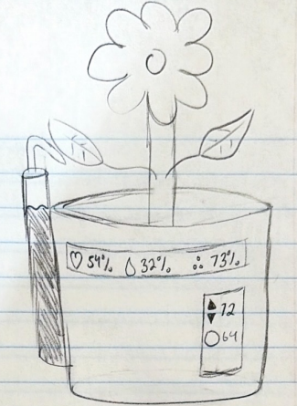
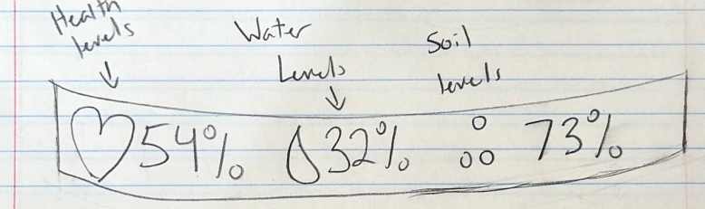
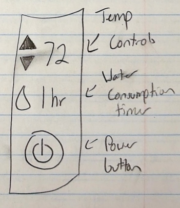

# Documentation

## How the project was implemented
This project is coded using svelte and javascript which is a frontend coding application. The project structure is broken down into multiple parts.

### Core
The core of the project is the entire page. This portion holds the components created to put the site together. This includes the section breakdown, cards to divide up features, and the individual features to communicate with eachother and share data.

### Features
These are the reusable components that can be moved anywhere on the site. The design behind this is to create more legible code when trying to debug or read the codebase. Features are broken down by what the purpose of what they are trying to accomplish. All features share data with eachother to work together.

### Data
This holds all of the mockdata used for the prototypes. The data is preset values users can use when testing the prototypes. The data makes the features interactive in showing how the product works when in production.

### How AI was used
AI is used to structure the project and make clean code. When designing each feature AI helped with how the features should share data between eachother to create a clean simulation of how the product will be looking in production

### Future Work
For future work a mobile application is planned to be designed. This will let users see metrics of their plant(s) and control manual features while they are away from home. The plant pot will also upload data over time for users to see historical data on their account from the mobile application.

# Demo
Below you can view a short demonstration of how the prototype is meant to be used!
**I will have a link for a video that will show the process of using the prototype**
[Smart Plant Pot Demo](src/assets/smartplantpotdemo.mp4)

# Sketches
Below are the initial sketches created before writing any code. The purpose of these sketches was to get a visual view of how the project should be strucutured. Though they are not detailed they properly show the process of the first step into making the prototype through code.

**Here I will have links to images that you will need to attach**

